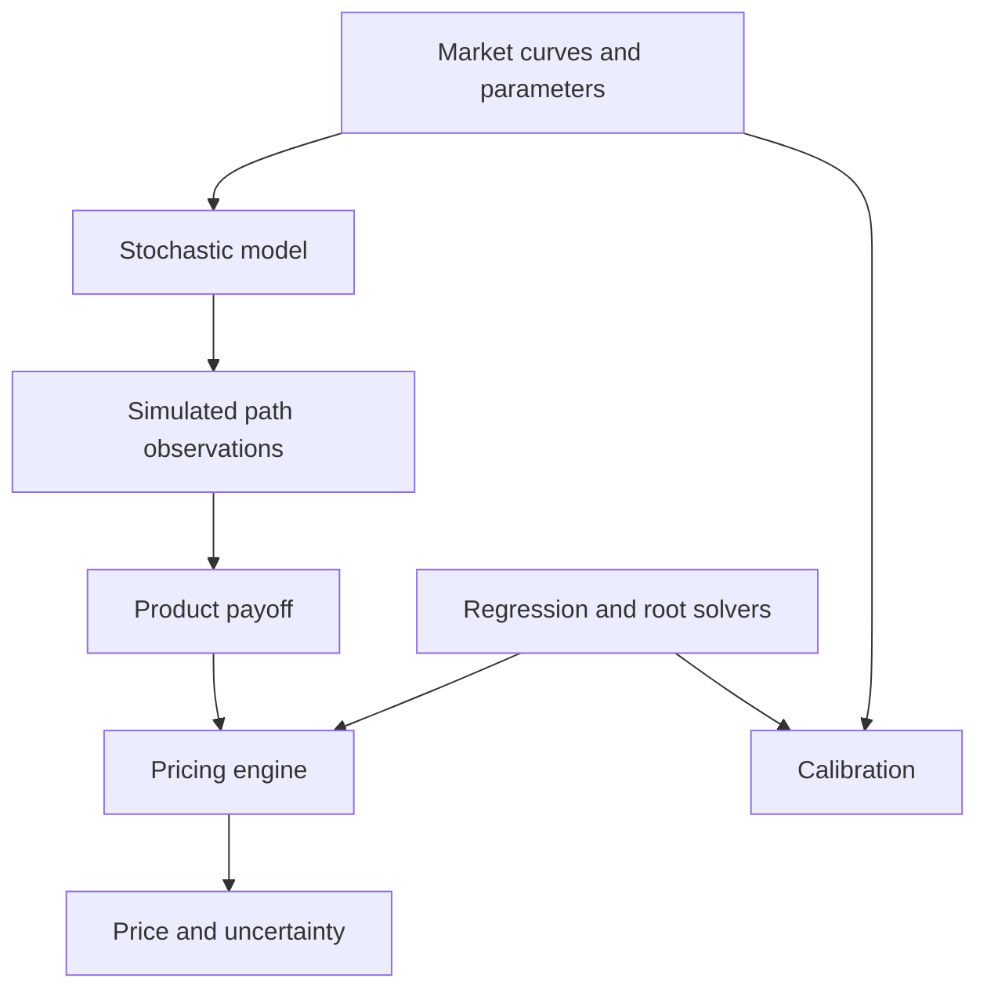

# Architecture: path-driven finance

The design centres on **policies and values**, not a base `Model` class or
time-indexed valuation container. I include (so far) finite-difference, multi-asset, rates and calibration modules (**is in progress**).

The pricing system has additional engines that can be used independently:

| Path or method | Inputs | Output |
| --- | --- | --- |
| Correlated multi-asset Monte Carlo | Spotted assets, volatilities, correlation and a joint payoff | Basket/exotic estimates with sampling errors |
| Crank–Nicolson / projected SOR | Black–Scholes parameters, exercise right and grid | European/American price and grid Greeks |
| Single-curve rates analytics | Discount curve, schedule, strike and volatility convention | Caplet, floorlet, swap or swaption PV |
| SVI / Hull–White calibration | Market quotes and constrained parameters | Fitted model and weighted errors |
| Scenario risk | Pricing function, bumps, portfolio trades and scenarios | Greeks, aggregated exposures, VaR/ES |

## Key design choices

1. **Compile-time model contract.** The `PathModel` concept requires `validate`,
   `initial`, `evolve` and `observe`. It does not require runtime inheritance,
   a shared pointer, or virtual methods.
2. **Models own the state dynamics.** The same engine simulates a lognormal
   stock, an arithmetic forward or a mean-reverting rate.
3. **Products consume histories.** European, Asian and barrier products are
   simple callable values taking a span of observations.
4. **Discounting belongs to the path.** Asset models provide deterministic
   short-rate discounting; interest-rate models integrate stochastic rates.
5. **Monte Carlo reuses the model/product composition.** Antithetic sampling
   accelerates basic estimators. American exercise is an additional LSM engine.
6. **Analytic formulas act as regression benchmarks.** Black–Scholes,
   Bachelier and bond prices verify stochastic computations independently.

## Extensions (happening soon)

- New product: implement `double operator()(std::span<const Observation>)`.
- New one-factor model: implement the four-method `PathModel` contract.
- New pricing method: accept a model and a payoff, without changing either.
- New curves: replace or expand `market` objects independently of pricing.
- New PDE solver: use a price process and product-specific terminal/boundary
  conditions without requiring any simulated histories.
- New calibration: use `optimisation::nelder_mead` or a future robust solver
  with market-quote validation and explicit parameter constraints.
